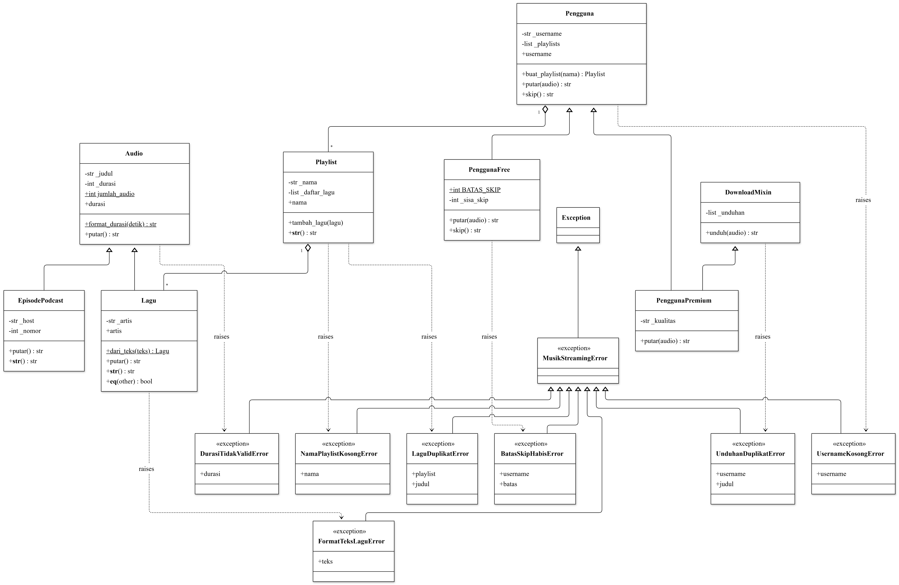

## APLIKASI MUSIK STREAMING

## Identitas
- Nama kelompok: Kelompok Warung
- Anggota: 
    1. Antonius Aston Delfan (2501020078)
    2. ⁠I Wayan Farrel Ichiro (2501020067)
    3. ⁠Muhamad Iqbal Ar'rayyan (2501020082)
- Studi kasus UTS: Aplikasi Musik Streaming

## Deskripsi Sistem
Aplikasi musik streaming sederhana. `Audio` adalah class induk dengan turunan `Lagu` dan `EpisodePodcast`. `Pengguna` memiliki kumpulan `Playlist` dan terbagi menjadi `PenggunaFree` (diiklankan dan dibatasi skip) serta `PenggunaPremium` (dapat mengunduh lewat `DownloadMixin`). Pada tugas P9, setiap penolakan data atau pelanggaran aturan bisnis dilaporkan melalui custom exception, bukan `print` atau nilai kembalian.

## Tabel Aturan Bisnis
| Aturan | Class/Method | Exception |
|---|---|---|
| Durasi audio harus lebih dari 0 detik | `Audio.durasi` (setter) | `DurasiTidakValidError` |
| Teks lagu harus berformat judul-artis-menit:detik | `Lagu.dari_teks` | `FormatTeksLaguError` |
| Nama playlist tidak boleh kosong | `Playlist.nama` (setter) | `NamaPlaylistKosongError` |
| Lagu yang sama tidak boleh ditambahkan dua kali | `Playlist.tambah_lagu` | `LaguDuplikatError` |
| Pengguna Free dibatasi 6 kali skip | `PenggunaFree.skip` | `BatasSkipHabisError` |
| Username tidak boleh kosong | `Pengguna.username` (setter) | `UsernameKosongError` |
| Audio yang sama tidak boleh diunduh dua kali | `DownloadMixin.unduh` | `UnduhanDuplikatError` |

## Class Diagram Revisi


## Daftar Custom Exception
| Nama | Class induk | Atribut konteks | Kapan dimunculkan | Method | Penanganan |
|---|---|---|---|---|---|
| `MusikStreamingError` | `Exception` | - | Base exception aplikasi | - | Penangkap umum di `main` |
| `DurasiTidakValidError` | `MusikStreamingError` | `durasi` | Durasi kurang dari atau sama dengan 0 | `Audio.durasi` | Pesan gagal ubah durasi |
| `FormatTeksLaguError` | `MusikStreamingError` | `teks` | Teks lagu salah format | `Lagu.dari_teks` | Pesan gagal beserta `__cause__` |
| `NamaPlaylistKosongError` | `MusikStreamingError` | `nama` | Nama playlist kosong | `Playlist.nama` | Pesan gagal membuat playlist |
| `LaguDuplikatError` | `MusikStreamingError` | `playlist`, `judul` | Lagu sudah ada di playlist | `Playlist.tambah_lagu` | Pesan gagal tambah lagu |
| `BatasSkipHabisError` | `MusikStreamingError` | `username`, `batas` | Sisa skip habis | `PenggunaFree.skip` | Pesan gagal skip |
| `UsernameKosongError` | `MusikStreamingError` | `username` | Username kosong | `Pengguna.username` | Pesan gagal membuat pengguna |
| `UnduhanDuplikatError` | `MusikStreamingError` | `username`, `judul` | Audio sudah pernah diunduh | `DownloadMixin.unduh` | Pesan gagal unduh |

## Penerapan Exception Handling
- `try/except/else/finally`: dipakai pada penambahan lagu ke playlist di `main.py`, dengan urutan `except` dari spesifik (`LaguDuplikatError`) ke umum (`MusikStreamingError`).
- `raise ... from e`: dipakai pada `Lagu.dari_teks`, penyebab aslinya ditampilkan lewat `e.__cause__`.
- EAFP: `Lagu.dari_teks` langsung melakukan `split` dan `int`, lalu menangkap `ValueError`. Di `main.py`, operasi `tambah_lagu`, `skip`, dan `unduh` langsung dijalankan di dalam `try`, lalu kegagalannya ditangkap tanpa pemeriksaan di muka.
- LBYL: `Playlist.tambah_lagu`, `PenggunaFree.skip`, dan `DownloadMixin.unduh` memeriksa aturan bisnis lebih dulu karena murah diperiksa.
- Class domain tidak mencetak pesan error. Penampilan pesan dilakukan di `main.py`.

## Cara Menjalankan
```
python src/main.py
```
Contoh output:
```
=== PLAYLIST ===
Berhasil menambahkan Iqro
[LOG] percobaan tambah lagu Iqro
Gagal tambah lagu: Lagu 'Senja di Kuta' sudah ada di playlist Lagu Santai
[LOG] percobaan tambah lagu Senja di Kuta
Playlist Lagu Santai: 3 lagu, 10:58

=== PENGGUNA FREE ===
[Iklan] Memutar lagu Senja di Kuta oleh Arya
ibal melewati lagu (sisa skip: 5)
ibal melewati lagu (sisa skip: 4)
ibal melewati lagu (sisa skip: 3)
ibal melewati lagu (sisa skip: 2)
ibal melewati lagu (sisa skip: 1)
ibal melewati lagu (sisa skip: 0)
Gagal skip: Batas skip habis, upgrade ke Premium

=== PENGGUNA PREMIUM ===
Memutar podcast Ngobrol Teknologi eps. 12 bersama Budi [320 kbps]
Langit Biru berhasil diunduh
Gagal unduh: Audio 'Langit Biru' sudah diunduh oleh sari

=== VALIDASI DAN PERBANDINGAN ===
Gagal ubah durasi: Durasi harus lebih dari 0 detik, diberikan -10
Gagal membuat lagu: Format teks lagu 'Langit Biru-Dewi' tidak valid, gunakan judul-artis-menit:detik
Penyebab: not enough values to unpack (expected 3, got 2)
Gagal membuat playlist: Nama playlist tidak boleh kosong
Gagal membuat pengguna: Username tidak boleh kosong
lagu1 == lagu3: True
lagu1 == lagu2: False
Jumlah audio: 6
MRO Premium: PenggunaPremium -> DownloadMixin -> Pengguna -> object
Ngobrol Teknologi bersama Budi (eps. 12, 30:00)
Playlist Lagu Santai: 3 lagu, 10:58
Senja di Kuta oleh Arya (3:35)
```

## Pembagian Peran
| Anggota | Peran |
|---|---|
| Aston (2501020078) | `exceptions.py` (base), `audio.py`, `lagu.py`, `episode_podcast.py`, class diagram |
| Ichiro (2501020067) | `playlist.py`, README |
| Iqbal (2501020082) | `pengguna.py`, `main.py`, output program |